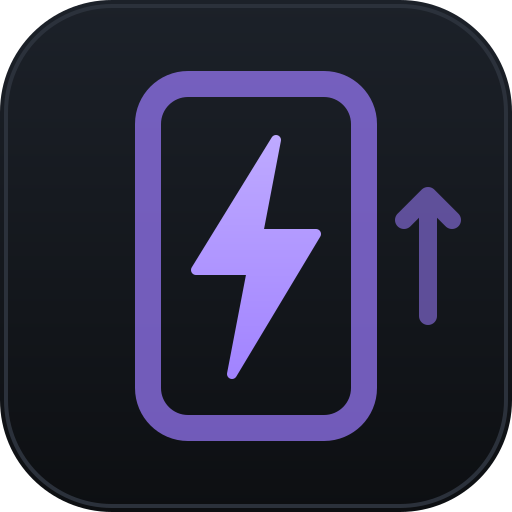
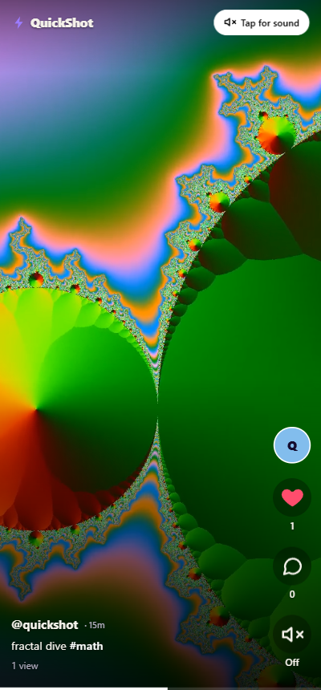
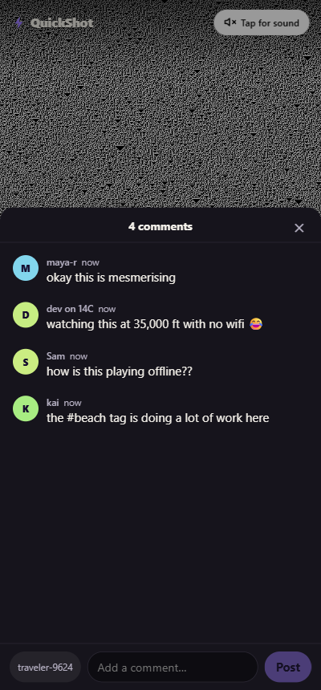

<p align="center"></p>

# QuickShot: an endless feed of your own clips

An [AirplaneMode](https://github.com/jessewolcott/airplanemode) app. QuickShot plays the short
videos in [Drop](https://github.com/jessewolcott/airplanemode-drop)'s **QuickShot** folder as a
full-screen vertical feed you swipe through, on every phone on the hotspot, with no internet.

<p align="center">
  
  
</p>

<sub>Screenshots from the laptop dev stack; not yet tested on real hardware.</sub>

- **Swipe forever.** Clips you haven't seen come first (newest first), then everything,
  shuffled; when it runs out it reshuffles, avoiding the ones you just watched.
- **Feels like a real feed.** Likes, views and comments are shared by everyone on the hotspot.
  Double-tap for a heart. Subfolders are "creators": clips in `QuickShot/Beach` show as
  **@beach**. Captions come from file names, `#tags` included.
- **New uploads show up.** Drop a clip into the folder from any device and it's slotted in
  right after the one you're watching, within 30 seconds.
- **Fast.** Only the clips around the one on screen have a player; the next ones load ahead.
  Portrait clips fill the screen, landscape ones fit.
- **Sound** starts off (browsers only allow autoplay that way); one tap turns it on for the
  rest of the feed.

QuickShot never touches the video files: the browser streams them straight from Drop, so it
runs in 64 MB. If the folder doesn't exist yet, QuickShot offers to create it.

## Comments, likes and views

They're kept in the app's volume (`/data/comments.json`, `/data/stats.json`), so they survive
restarts and updates; on the box that's the `quickshot-data` named volume.

- No accounts: each browser makes up a random viewer id and a display name (changeable). The
  API never shows one viewer's id to another.
- A like counts once per device; a view once per device per clip every 30 minutes.
- Comments are up to 300 characters, the newest 500 per clip are kept, one every 3 seconds per
  device. People can delete their own; **the AirplaneMode admin can delete any** (whoever is
  signed in to the admin panel, checked the same way Drop does).
- When a clip is deleted from Drop, its counts and comments go too.

## Running it

**On the box:** the platform repo runs the released image at `/quickshot/`, next to Drop.

**On its own, for development** (with Drop built from `../airplanemode-drop`):

```
docker compose up -d --build        # QuickShot http://localhost:8769, Drop http://localhost:8766
python tests/test_quickshot.py      # API tests (CI runs these before building)
```

## Settings

| Variable | Default | Meaning |
|---|---|---|
| `DROP_URL` | `http://drop:8000` | Drop's API, as this container reaches it |
| `DROP_PATH` | `../drop/` | where the browser streams from |
| `QUICKSHOT_FOLDER` | `QuickShot` | the top-level Drop folder to play (any capitalisation) |
| `ADMIN_URL` | *(empty)* | the platform's admin service, so the admin can delete any comment |

*Not yet tested on real hardware.*
